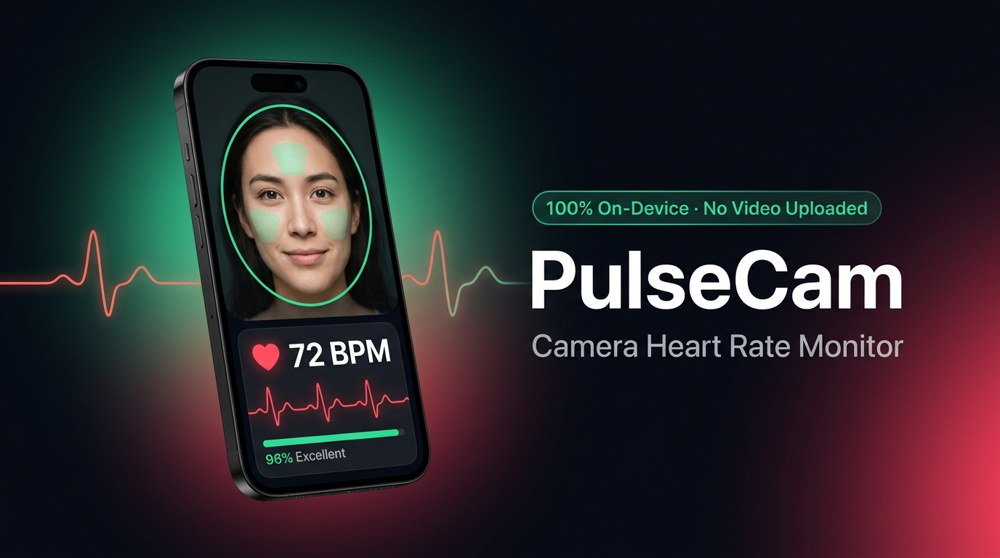

# PulseCam — On-Device Camera Heart Rate Monitor

<p align="center">
  <a href="https://johnyquest7.github.io/FaceHR/">
    
  </a>
</p>

<p align="center">
  <strong><a href="https://johnyquest7.github.io/FaceHR/">Try the Live HTTPS App on Phone or Laptop →</a></strong>
</p>

**PulseCam** is a 100% on-device Progressive Web App (PWA) that estimates heart rate (BPM) in real time using your laptop or smartphone camera via **facial remote photoplethysmography (rPPG)**.

No video frames, facial landmarks, or biometric signals ever leave your device.

---

## How It Works (100% On-Device)

Every heartbeat causes subtle, microscopic changes in blood volume beneath facial skin, slightly altering how light is absorbed and reflected (strongest in the green channel, weakest in red). PulseCam extracts this pulse signal entirely in your browser:

1. **Mobile-Optimized Camera & Facial ROI Tracking (`@mediapipe/tasks-vision`)**:
   - Locks smartphone **Auto-Exposure (AE)**, **Auto-White-Balance (AWB)**, and focus after a brief `1.5 s` stabilization period when supported, and uses hardware frame timestamps (`requestVideoFrameCallback`) with 60/120 Hz deduplication.
   - Uses **MediaPipe Face Landmarker** (WebAssembly runtime packaged locally into `public/mediapipe/wasm/`) with aspect-preserving portrait/landscape buffers, adaptive landmark smoothing, and `±1.5 σ` specular glare/shadow outlier trimming across the **forehead**, **left cheek**, and **right cheek**.
   - Automatically falls back to YCbCr skin-color segmentation if WebAssembly/GPU tracking is unavailable.
2. **Multi-ROI SNR Fusion & 3-Algorithm Consensus (POS + OMIT + CHROM)**:
   - Runs **POS** (*Plane-Orthogonal-to-Skin*, Wang et al., IEEE TBME 2017) independently on forehead, left cheek, and right cheek, automatically excluding shadowed, glared, or occluded regions via SNR and physiological AC/DC plausibility weighting.
   - Cross-validates with illumination-normalized **OMIT** (*Orthogonal Matrix Image Transformation*) and **CHROM** (*Chrominance-based rPPG*, De Haan & Jeanne, IEEE TBME 2013) using SNR-weighted consensus clustering.
3. **Signal Processing & Quality Scoring**:
   - Uniform 30 Hz resampling and MAD-based step-jump despiking to handle mobile frame-rate jitter and abrupt exposure steps.
   - Linear detrending, Hann windowing, and zero-phase Butterworth bandpass filtering (**0.70–3.50 Hz**, corresponding to **42–210 BPM**).
   - Welch-assisted 4096-point FFT with parabolic peak interpolation, harmonic/subharmonic disambiguation, and physiological temporal tracking.
   - Live confidence score (0–100%) and color-coded face alignment outline (**solid green** = locked good/excellent signal).
4. **Demo Pulse Mode**:
   - Includes a built-in synthetic rPPG signal generator so you can verify the live DSP pipeline and UI even without a camera.

---

## Quick Start on Windows

### Prerequisites
- **Node.js 18+** (Node.js 20 LTS recommended) and **npm**

### Run Locally
```powershell
npm install
npm run dev
```

Open **`http://localhost:5173`** in Chrome or Edge. Browsers treat `localhost` as a secure context, so camera access works immediately without HTTPS.

### Useful Scripts
| Command | Purpose |
| --- | --- |
| `npm run dev` | Start local Vite dev server on `http://localhost:5173` |
| `npm run dev:https` | Start LAN-accessible HTTPS dev server for mobile testing |
| `npm run typecheck` | Run strict TypeScript typechecking (`tsc --noEmit`) |
| `npm test` | Run Vitest unit tests (DSP & vision pipelines) |
| `npm run build` | Typecheck and build the production PWA into `dist/` |
| `npm run preview` | Preview the production build locally |

---

## Testing on Your Mobile Phone (iOS Safari & Android Chrome)

Mobile browsers strictly require **HTTPS** before allowing access to `navigator.mediaDevices.getUserMedia()` on any non-localhost URL. Choose either option below:

### Option A: Local LAN HTTPS (Same Wi-Fi, No Extra Tools)

1. Connect your phone and Windows laptop to the **same Wi-Fi network**.
2. Find your laptop's local IPv4 address in PowerShell:
   ```powershell
   ipconfig
   ```
   Look for **IPv4 Address** under your Wi-Fi adapter (for example, `192.168.1.42`).
3. Start the HTTPS dev server:
   ```powershell
   npm run dev:https
   ```
   *(If Windows Defender Firewall prompts, allow Node.js access on Private networks.)*
4. On your phone, open **`https://<laptop-LAN-IP>:5173`** (e.g. `https://192.168.1.42:5173`).
5. Accept the self-signed development certificate once:
   - **iOS Safari**: Tap **Show Details** → **visit this website** → **Visit Website**.
   - **Android Chrome**: Tap **Advanced** → **Proceed to `<IP>` (unsafe)**.
6. Grant camera permission when prompted and tap **Start Heart Rate Scan**.

### Option B: Instant Trusted HTTPS Tunnel (Zero Certificate Warnings)

Use Cloudflare's free Quick Tunnel to get a real, browser-trusted HTTPS URL in seconds — ideal for iPhone and Android testing with no certificate prompts:

1. Start the standard dev server in one terminal:
   ```powershell
   npm run dev
   ```
2. In a second terminal, open a tunnel to port `5173`:
   ```powershell
   npx cloudflared tunnel --url http://localhost:5173
   ```
3. Copy the generated `https://<random-name>.trycloudflare.com` URL and open it directly on your iPhone or Android phone.

---

## Deploying Permanently Over HTTPS & Installing as a PWA

All three hosting targets below automatically serve PulseCam over HTTPS with full camera and PWA support.

### Netlify (`netlify.toml` included)
- Connect this repository in the Netlify dashboard (build command `npm run build`, publish directory `dist`, SPA routing, `Permissions-Policy: camera=(self)`, security headers, and WASM caching are pre-configured in `netlify.toml`).
- Or deploy from your terminal:
  ```powershell
  npm run build
  npx netlify-cli deploy --prod --dir=dist
  ```

### Vercel (`vercel.json` included)
- Import this repository in Vercel — `vercel.json` automatically configures Vite build settings, SPA rewrites, `Permissions-Policy: camera=(self)`, security headers, and asset/WASM caching.
- Or deploy from your terminal:
  ```powershell
  npx vercel --prod
  ```

### GitHub Pages (`.github/workflows/deploy.yml` included)
1. Push this repository to GitHub with a `main` branch.
2. In your GitHub repo, go to **Settings → Pages** and set **Source** to **GitHub Actions**.
3. Every push to `main` automatically runs typecheck, unit tests, builds with `VITE_BASE_PATH=/<repo-name>/`, and publishes `dist/` over HTTPS to `https://<username>.github.io/<repo-name>/`.

### Installing as a PWA (Add to Home Screen)
- **Android Chrome / Desktop Chrome & Edge**: Tap the in-app **Install App** button (or browser menu → **Install app / Add to Home screen**).
- **iOS Safari**: Tap the **Share** button (square with up arrow) → **Add to Home Screen** → **Add**. PulseCam will launch full-screen like a native app.

---

## Best Practices for Accurate Readings

- **Use even, steady lighting**: Face a window or soft diffuse lamp. Avoid strong backlighting, harsh shadows across your face, or dim rooms.
- **Stay still for 10–15 seconds**: Rest your phone on a stand or hold it steady at arm's length (~30–50 cm). Avoid talking, smiling broadly, or chewing while measuring.
- **Keep your forehead and cheeks clearly visible**: Center your face in the guide frame and keep hair or hats off your forehead when possible.
- **Watch the Signal Quality meter**: Readings converge after ~6 seconds of warm-up and reach peak accuracy around 12–14 seconds when Signal Quality shows **Good** or **Excellent**.

---

## Disclaimer

> **For wellness, fitness, and experimental use only — NOT a medical device.**
>
> PulseCam estimates heart rate optically from a standard consumer camera and is sensitive to lighting, movement, camera auto-exposure, and skin perfusion. It is not intended to diagnose, treat, cure, or prevent any disease or medical condition, and should not be used for clinical or emergency decisions.
